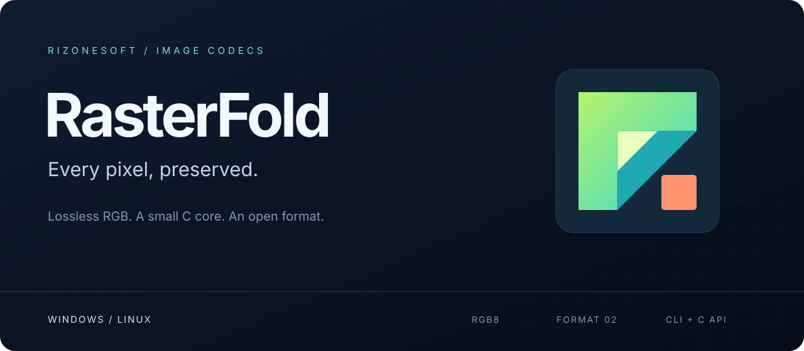

<p align="center"></p>

<p align="center">
<a href="https://github.com/rizonesoft/RasterFold/actions/workflows/build.yml?query=branch%3Amain+event%3Apush"></a>
<a href="https://github.com/rizonesoft/RasterFold/actions/workflows/plan.yml?query=branch%3Amain+event%3Apush"></a>
<a href="LICENSE"></a>
<a href="spec/FOLD.md"></a>
</p>

<p align="center"><a href="docs/building.md">Build</a> · <a href="docs/library.md">Use the library</a> · <a href="spec/FOLD.md">Read the format</a> · <a href="docs/research.md">Explore the research</a> · <a href="CONTRIBUTING.md">Contribute</a></p>

RasterFold is a lossless RGB image codec written in C11. It turns 24-bit BMP and 8-bit PNG images into `.fold` files and restores every pixel exactly. Use the command line, or embed the same codec through a small, versioned C API.

The project is in active development. Windows and Linux executables and libraries are exercised locally.

## What is here

- **One format, identical bytes.** Format v3 has an independent Python oracle and frozen known-answer files (version 2 files still decode). Thread count does not change encoded output.
- **CLI and library.** Five C entry points provide encoding, decoding, validated inspection, version discovery and memory release. Shared and static libraries use the same core as the CLI.
- **Careful file handling.** The CLI refuses existing destinations, writes an exclusive `.partial` file, flushes it, and publishes without replacing another file.
- **A local, pinned toolchain.** LLVM and Ninja live under ignored `tools/` directories, with checked download hashes. Windows builds retain their freestanding Win32 core.
- **Measured research.** Compression ideas are tested on a corpus with separate tuning and confirmation sets. [Historical Windows results](docs/measurements.md) remain available with their conditions and limitations.

| Target | Executable | Shared library | Static library |
| --- | --- | --- | --- |
| Windows x64 | `rasterfold.exe` | `rasterfold.dll` + MinGW/MSVC import libraries | `librasterfold.a` |
| Linux x64 | `rasterfold` | `librasterfold.so` | `librasterfold.a` |

## Build in WSL or Linux

```bash
python3 tools/provision.py
source .venv/bin/activate
./build.sh --target all
python3 scripts/check-all.py --all-targets
```

Outputs land in `bin/<target>/`, organized into `bin/` for executables and Windows DLLs, `lib/` for libraries, `include/` for headers and `symbols/` for Windows PDBs. The compiler and SDK downloads stay inside the repository and are not committed. Python, Git, PowerShell 7 (`pwsh`, for PowerShell gate and automation wrappers), and the native Linux C development headers are host prerequisites. [The build guide](docs/building.md) covers Windows, individual targets, verification and packaging.

## Encode, decode, inspect

```bash
bin/linux-x64/bin/rasterfold encode --time input.bmp output.fold
bin/linux-x64/bin/rasterfold decode output.fold restored.bmp
bin/linux-x64/bin/rasterfold inspect output.fold
```

Use `bin/windows-x64/bin/rasterfold.exe` on Windows. `--threads 1` requests the single-thread path; the default uses up to nine channel and strip threads when the CPU allows it. The current CLI accepts RGB8 BMP and 8-bit RGB or fully opaque RGBA PNG. JPEG, a non-opaque alpha channel, and animation are not accepted; those are future work, not hidden capabilities.

## Embed the codec

Include [`rasterfold.h`](include/rasterfold.h), link a shared or static library, and release returned allocations with `rf_free`. The API accepts packed or padded top-down RGB8, uses per-call errors, and supports concurrent calls with distinct output objects. It performs no file I/O.

[The library guide](docs/library.md) explains ownership and linking. The [C examples](examples/) encode and decode PPM images and are compiled and exercised by the artifact tests.

## Development and automation

The [execution plan](todo/implementation-plan.md) owns planned work. [AGENTS.md](AGENTS.md) and [GEMINI.md](GEMINI.md) define format fidelity, review and measurement rules. Claude Code, Codex and Antigravity can write, with skills in `.agents/skills/`, campaign `Stop` hooks and `scripts/campaign_guard.py`. Independent reviews route through `scripts/review-dispatch.py` to Gemini 4 Carbon through the Antigravity CLI for Codex and GPT-6 Astra through the Codex CLI for the other writers.

Contributions should improve images in general. A size or speed claim needs the [measurement protocol](docs/research.md), its inputs, command and thread count. Reproducing one attractive result is not enough to claim a general win over JPEG XL.

Read the [contribution guide](CONTRIBUTING.md), [security policy](SECURITY.md) and [code of conduct](CODE_OF_CONDUCT.md). RasterFold is licensed under [GPL-3.0](LICENSE).

<!-- drift:begin readme-capabilities -->
Current codec: format 3, C API 1.0, RGB8. Maximum dimension: 32768; maximum image: 33554432 pixels. The native converter and full Pages site are planned in [the product vision](docs/vision.md).
<!-- drift:end readme-capabilities -->
