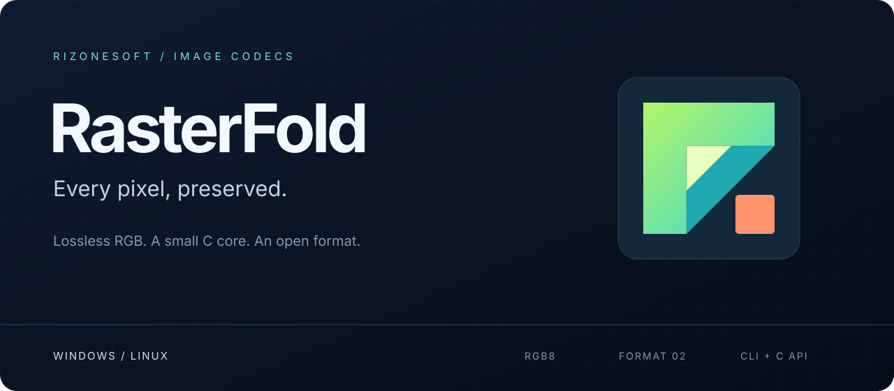

# RasterFold Documentation

RasterFold is a lossless RGB image codec written in C11 for Windows x64, Linux x64, Android ARM64, and Android x64. It supplies a command-line tool (`rasterfold` / `rasterfold.exe`) and shared and static C libraries through `include/rasterfold.h`.

## Current Version and Limits

- **Encoded format:** `.fold` format version 2 <!-- drift:fact format_version = 2 --> (`32`-byte header <!-- drift:fact header_bytes = 32 -->, CRC-32 verified header and payload).
- **Public C API:** version 1.0 (`RF_API_VERSION_MAJOR = 1` <!-- drift:fact api_major = 1 -->, `RF_API_VERSION_MINOR = 0` <!-- drift:fact api_minor = 0 -->).
- **Image limits:** maximum dimension `32768` pixels <!-- drift:fact max_dimension = 32768 -->; maximum image `33554432` pixels <!-- drift:fact max_pixels = 33554432 -->; maximum file size `268435456` bytes <!-- drift:fact max_file_bytes = 268435456 -->.
- **Current vs. planned scope:** the CLI and C library for 24-bit RGB8 BMP and in-memory RGB8 buffers are current and verified on Windows and Linux x64 (with Android ARM64/x64 cross-compiled via the pinned NDK). The native desktop/mobile converter application is planned work and is not yet offered as a downloadable package.

## Documentation Map

- [Getting Started](getting-started.md): provision the pinned toolchain, build all four targets, and run the first encode, decode, and inspect commands.
- [CLI and Library Usage](usage.md): target artifacts, CLI commands and flags, exit codes, and C API embedding overview mirrored from the repository README.
- [Format Specification](format.md): the normative `.fold` version 2 container and context-mixing (CM) bitstream specification mirrored from `spec/FOLD.md`.
- [Benchmarks](benchmarks.md): corpus and reference-image measurements comparing RasterFold with JPEG XL (`e7` and `e9`), lossless WebP, and PNG.
- [Research Summary](research-summary.md): where the codec stands, the measurement protocol, experiments already tried, and prior art mirrored from `docs/research.md`.
